<table>
<tr>
<td valign="top"></td>
<td valign="top"></td>
</tr>
</table>

Everything in these repos ran on my machine before it went public.

<a href="https://github.com/charlesjacobb/drops">drops</a> ·
<a href="https://github.com/charlesjacobb/carousel-engine">carousel-engine</a> ·
<a href="https://www.instagram.com/charlesjacob.ai/">instagram</a> ·
<a href="https://charles-jacobs-newsletter.beehiiv.com/subscribe">newsletter</a>

